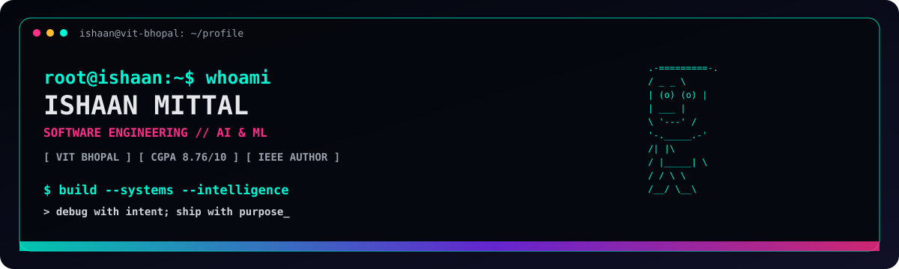

<div align="center">



# ISHAAN_MITTAL.exe
### SOFTWARE ENGINEERING // AI & ML // PRODUCT SYSTEMS

[](https://itsmeishaan.vercel.app/)
[](https://www.linkedin.com/in/ishaan-mittal29/)
[](mailto:ishaanmittal999@gmail.com)
[](https://github.com/kalicharm21)

`[ SYSTEM ONLINE ] [ VIT BHOPAL // CSE (AI & ML) ] [ CGPA: 8.76/10 ]`

</div>

---

## `01 // PLAYER PROFILE`

```text
> identity.load("Ishaan Mittal")
> role   : Software Engineering | AI/ML | Product & Business Operations
> status : B.Tech CSE (AIML), VIT Bhopal — 2023–2027
> focus  : scalable software, intelligent workflows, API systems
> loop   : build -> measure -> debug -> ship
```

I work across **software engineering, AI/ML pipelines, API systems, and product operations**—turning practical requirements into user-centric software. I enjoy designing reliable APIs, improving data workflows, testing edge cases, and making systems faster and easier to use.

## `02 // TECH ARSENAL`

<p align="center">
  
</p>

| MODULE | TOOLS / CAPABILITIES |
|---|---|
| Languages | Python · Java · C++ · TypeScript · JavaScript · SQL · Bash |
| Software & Web | React · Next.js · Node.js · Express · FastAPI · REST APIs · OOP · Design Patterns · TDD |
| Data & Systems | PostgreSQL · MySQL · Supabase · MongoDB · Relational Modeling · Docker · Git |
| AI / ML | Scikit-learn · OpenCV · MediaPipe · Gemini Vision API · Groq SDK · LLM Integration · Model Evaluation |
| Product / Ops | Requirements Scoping · Workflow Mapping · KPI Tracking · Root-Cause Triage · Stakeholder Alignment |

## `03 // DEPLOYED PROJECTS`

<details open>
<summary><b>FINOVA // Enterprise Invoicing & Financial Tracking</b></summary>

**Stack:** Python · PostgreSQL · Supabase · Next.js · Gemini Vision

- Designed a multi-tenant platform with OOP patterns, asynchronous protocols, and Row-Level Security for transactional data isolation.
- Automated invoice extraction with Gemini Vision, reducing manual invoice logging by **75%**.
- Tuned **12 relational queries** with composite B-tree indexes, reducing execution latency by **60%** and targeting sub-200 ms responses.

</details>

<details>
<summary><b>ShopSense // Voice-Activated Conversational Commerce</b></summary>

**Stack:** TypeScript · Next.js · Groq · PostgreSQL

- Built a voice-driven retail assistant that recognizes speech intent and manages shopping-list items with **sub-250 ms interaction latency**.
- Added recipe intelligence to parse dishes into ingredients and sync carts across active sessions.
- Implemented predictive exhaustion analytics for proactive replenishment alerts.

</details>

<details>
<summary><b>VITMESS // Campus Mess Utility</b></summary>

- A campus-focused PWA for checking mess menus, timings, and meal information.
- Includes feedback access and a convenient installable experience across devices.

</details>

<details>
<summary><b>WorkQuanta // Real-Time Scheduling</b></summary>

- A real-time scheduling project focused on WebSockets, responsive updates, and streamlined workflow coordination.

</details>

## `04 // EXPERIENCE LOG`

**Product Intern — Phyllo** `Oct 2025 – Nov 2025`
- Tested functional and regression behavior across **10+ REST endpoints** in Postman, validating schemas, boundary cases, and response codes.
- Authored API references, endpoint contracts, and schema definitions to support developer onboarding.
- Investigated server telemetry and edge failures, cutting root-cause triage turnaround by **20%**.

**Software Engineer Intern (AI & Systems) — amasQIS.ai** `Mar 2025 – Sep 2025`
- Built **5 annotation interfaces** for image and text workflows, supporting **1,000+ daily sessions**.
- Improved dataset quality by **30%** through agreement checks and confidence-based scoring.
- Integrated Hugging Face pre-labeling routines, reducing manual annotation turnaround by **40%**.

## `05 // RESEARCH & ACHIEVEMENTS`

- **IEEE ICAAIC 2025 publication** — *Clinical Decision Support through Machine Learning: Benchmarking LightGBM and Deep Learning Models for Diabetes Onset Prediction.* Used 5-fold cross-validation; reported a **0.79 F1 score** and **3× faster execution** under resource-constrained profiles.
- **Repdox National Hackathon — 1st Runner-Up:** contributed to Bharat Pulse AI, an offline-resilient edge system.
- **IBM Cybersecurity Analyst** (Data Governance) · **Deloitte GenAI Explorer** · **AlgoUniversity Graph Camp**
- **Outreach Lead, iOS Club — VIT Bhopal:** organized 6 technical workshops and hackathons for 400+ attendees.
- **Vice President, Music & Band Club — VIT Bhopal:** helped lead logistics and budgets for 15+ festivals.

## `06 // CONTRIBUTION ARCADE`

### `SNAKE.exe // eats contributions, not bugs`

The snake animation is generated from your actual GitHub contribution graph. It updates when the workflow runs; it is not a live in-browser game.

<p align="center">
  
</p>

### `STREAK & ACTIVITY TELEMETRY`

<p align="center">
  
</p>

<p align="center">
  
</p>

<p align="center">
  
</p>

## `07 // CONNECT TO OPERATOR`

- **Portfolio:** https://itsmeishaan.vercel.app/
- **LinkedIn:** https://www.linkedin.com/in/ishaan-mittal29/
- **Email:** ishaanmittal999@gmail.com

<div align="center">`[ END OF TRANSMISSION ] // KEEP BUILDING. KEEP SHIPPING.`</div>
